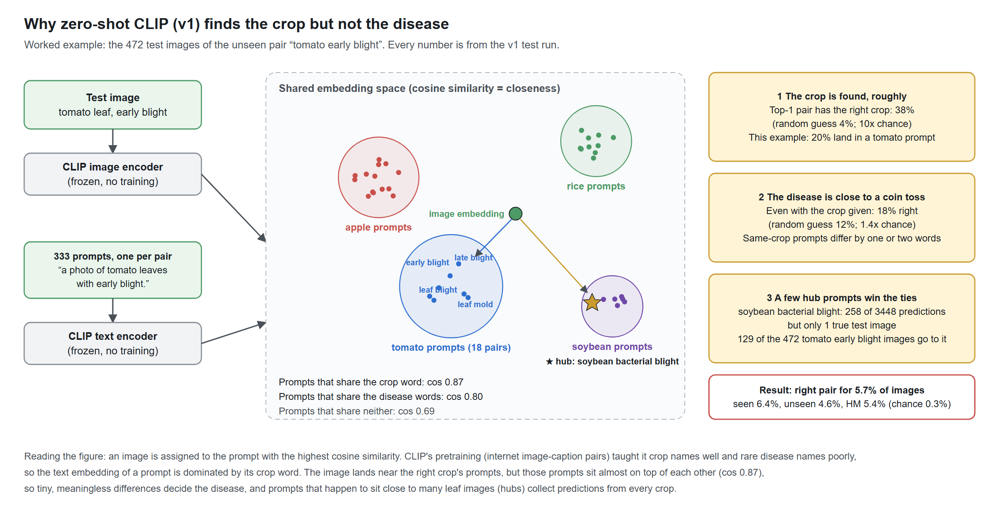

# v1 baseline: results and what they show

v1 is off-the-shelf CLIP ViT-B/16 used with no training. Each of the 333 crop–disease pairs becomes one prompt,
"a photo of {crop} leaves with {disease}.". Each test image is assigned to the prompt with the highest cosine
similarity. There is no calibration (γ = 0): the model was never trained on the seen pairs, so it has no learned
preference for them to correct.

## Results

| | Seen (2,000 images, 323 pairs) | Unseen (1,448 images, 10 pairs) | Harmonic mean |
|---|---|---|---|
| Top-1 | 6.4% | 4.6% | **5.4%** |
| Top-5 | 20.7% | 16.6% | 18.4% |

A random guess over 333 pairs gets 0.3% Top-1. So v1 is about 18 times better than chance, but it still gets 19 of
every 20 images wrong. Its area under the seen–unseen curve (AUSUC, a summary that does not depend on γ) is 2.0%.

### Comparison with the CNN baselines

The CNN baselines train one ImageNet-pretrained network for the crop and one for the disease. A pair's score is
log P(crop) + log P(disease), so they can also score unseen pairs whose crop and disease were each seen in training.
ConvNeXt-Base is the stronger CNN baseline; ResNet-50 is shown for reference. All numbers are on the same test set.

| Metric | v1 (zero-shot CLIP) | ConvNeXt-Base | ResNet-50 |
|---|---|---|---|
| Training images used | 0 | 8,000 | 8,000 |
| **Without calibration (γ = 0)** | | | |
| Seen Top-1 / Top-5 | 6.4 / 20.6 | 74.2 / 91.3 | 67.2 / 88.9 |
| Unseen Top-1 / Top-5 | 4.6 / 16.6 | 14.8 / 49.6 | 8.1 / 38.9 |
| **HM Top-1** / Top-5 | **5.4** / 18.4 | **24.7** / 64.3 | **14.5** / 54.1 |
| Unseen images sent to an unseen pair | 7.5 | 14.9 | 8.4 |
| **With calibration (γ chosen on validation)** | | | |
| γ (log-probability units) | – (not applicable) | 6.4 | 6.5 |
| Seen Top-1 / Top-5 | – | 64.5 / 88.3 | 54.9 / 85.2 |
| Unseen Top-1 / Top-5 | – | 73.3 / 99.4 | 65.5 / 90.3 |
| **HM Top-1** / Top-5 | – | **68.6** / 93.5 | **59.7** / 87.7 |
| **Independent of γ** | | | |
| Closed-set seen Top-1 (only seen pairs ranked) | 6.5 | 74.2 | 67.2 |
| Closed-set unseen Top-1 (only the 10 unseen pairs ranked) | 43.1 | 91.2 | 75.8 |
| AUSUC | 2.0 | 62.6 | 47.2 |
| **Where the errors are (γ = 0)** | | | |
| Seen: crop right / disease right | 43.0 / 8.2 | 94.7 / 75.3 | 90.1 / 69.0 |
| Unseen: crop right / disease right | 31.6 / 8.5 | 85.9 / 18.3 | 66.6 / 14.8 |

All values in %, except γ. Calibration subtracts γ from every seen pair's score so that more images go to unseen
pairs. v1 has no γ because it was never trained on the seen pairs.

**v1 does not improve on the CNN baselines on any metric.** ConvNeXt-Base is ahead on every row, even uncalibrated
(HM 24.7% vs 5.4%), and even on unseen pairs ranked among themselves (91.2% vs 43.1%).

Disease recognition shows the largest gap. On seen images, ConvNeXt-Base gets the disease right 75% of the time and v1
8%. On crops the gap is smaller (95% vs 43%).

Both models are uncalibrated in the top half of the table, but for different reasons. The CNNs are seen-biased: at
γ = 0 they send only 0.1–0.2% of seen images and 8–15% of unseen images to unseen pairs, which is why their
uncalibrated unseen Top-1 is low. v1 is not seen-biased; its unseen score is low because it cannot tell the pairs
apart (see below). Its value is different. It is the reference point that
every trained CLIP version is measured against, and it shows what a vision–language model knows about this task
before it sees a single training image.

## How the model makes a decision

CLIP was pretrained with a contrastive objective (InfoNCE) on about 400 million image–caption pairs from the internet.
Training pulled each image's embedding towards the embedding of its own caption and pushed it away from the other
captions in the batch. The result is a **shared embedding space**: an image and a sentence that describes it end up
close together, measured by cosine similarity.

Zero-shot classification reuses this directly. The text embeddings of the 333 prompts act as the **weights of a linear
classifier**, one weight vector per class. An image is scored against every class by a dot product of unit vectors
(cosine similarity), and the highest score wins. No weight is learned for this task. The classifier is written
entirely by the text encoder, which is why v1 can score the 10 unseen pairs at all: a class only needs a name, not
training images.

The CNN baselines can score unseen pairs only by composing separately trained crop and disease predictions, which
requires every unseen crop and disease to have appeared in training on some other pair. A text-defined classifier has
no such requirement, and that is the reason the VLM branch exists. The rest of this
section explains why, in v1, this capability barely works.

## Why it fails: the crop is found, the disease is not

*Figure: the v1 decision for the unseen pair "tomato early blight" (472 test images). All numbers come from the v1 test
run; the figure is generated by `docs/vlm/diagrams/make_v1_results_figure.py`.*

Splitting each prediction into "is the crop right?" and "is the disease right?" shows where the 94% of errors come from:

| Top-1 prediction | Seen images | Unseen images |
|---|---|---|
| Crop and disease right (correct pair) | 6.4% | 4.6% |
| Crop right, disease wrong | 36.6% | 26.9% |
| Crop wrong, disease right | 1.8% | 3.9% |
| Both wrong | 55.3% | 64.6% |

Over all 3,448 test images, the predicted pair has the right crop 38% of the time, against 4% for a random guess
(about 10 times chance). If the crop is given and the model only has to choose among that crop's pairs, it picks the
right disease 18% of the time, against 12% for a random guess (about 1.4 times chance). **CLIP knows the crops and
almost nothing about the diseases.** Three mechanisms explain this.

### 1. The pretraining data covers crops, not plant pathology

What a contrastively trained model can recognise is limited to what appears often enough in its captions. "Tomato",
"apple" and "rice" are common words in internet captions, attached to many photos of the plant. Disease names such as
"cercospora", "aphis spp" or "verticillium wilt" are rare, and when they do occur, the photo is seldom a close-up leaf
image with visible lesions. This is a **long-tail and domain-shift problem**. The image encoder has had little reason
to learn the small visual differences between leaf lesions, and the text encoder has little to anchor rare disease
words to. Some raw class names make it worse: misspellings such as "xamthomonas" or "verticulium" are not even words
CLIP has seen.

### 2. The prompt embedding is dominated by the crop word

CLIP's text encoder is known to behave much like a **bag of words** for compositional phrases: it does not reliably
bind attributes to objects, and a salient, familiar word dominates the sentence embedding (Yuksekgonul et al., 2023).
The v1 prompts show this directly. Measured between prompt embeddings:

| Two prompts that share… | Mean cosine similarity |
|---|---|
| the crop word, not the disease | 0.87 |
| the disease words, not the crop | 0.80 |
| neither | 0.69 |

Prompts for the same crop sit almost on top of each other. "Tomato leaves with early blight", "...with late blight" and
"...with leaf blight" differ by one or two words in an otherwise identical sentence. So even when the image embedding
lands near the right crop's prompts, the margin between that crop's diseases is tiny, and small, meaningless
differences decide the disease. In the worked example, 20% of tomato early blight images land on a tomato prompt, and
the correct one is typically ranked around 8th of the 18 tomato pairs.

### 3. A few "hub" prompts collect predictions from every crop

Nearest-neighbour search in high-dimensional spaces suffers from **hubness**: a few points become the nearest
neighbour of a disproportionate share of queries (Radovanović et al., 2010). Here, "soybean bacterial blight" is the
top-1 prediction for 258 of the 3,448 test images, although only one test image actually belongs to it. The ten
biggest hubs take 38% of all predictions, while 94 of the 333 pairs are never predicted at all. In the worked example,
129 of the 472 tomato early blight images go to "soybean bacterial blight", probably helped by the shared word
"blight".

These hubs are not simply the prompts closest to all other prompts. "Soybean bacterial blight" ranks only 189th of 333
by average similarity to the other prompts. That points to how the leaf photos sit relative to the text embeddings.
Image and text embeddings in CLIP occupy separate regions of the space, the **modality gap** (Liang et al., 2022). Here
the mean image–prompt cosine is 0.28, against 0.69 between two prompts. Across that gap, whichever prompts happen to
lie slightly closer to the region of leaf photos win many unrelated images.

## The seen and unseen results tell different stories

The low unseen score is not caused by a bias towards seen pairs: v1 has never been trained on them. It is caused by
**competition**. When the 1,448 unseen images only have to choose among the 10 unseen pairs, v1 gets 43.1% right. When
the 323 seen pairs are added, which is the generalised zero-shot setting the task requires, accuracy falls to 4.6%.
Every unseen pair shares its crop word or its disease words with seen pairs. For example, "cucumber powdery mildew" is
unseen, but "pumpkin powdery mildew" and other cucumber pairs are not. Given mechanisms 2 and 3, those near-duplicates
and the hubs win the ties.

So the text side does carry real signal, enough to sort 10 clearly different unseen pairs 43% of the time. It is not
precise enough to separate a pair from its near-duplicates.

## What v1 establishes for the next versions

- **The zero-shot route works in principle.** Unseen pairs can be scored from their names alone, with no training
  images. This is the property the later versions keep.
- **The gap to close is disease knowledge, not crop knowledge.** 37% of seen images already get the crop right and the
  disease wrong. Every later version should be judged mainly on whether it separates diseases within a crop.
- **Both sides of the model need work.**
  - Text side: names that CLIP can read (v2), richer disease descriptions (v3), and learned crop and disease vectors
    (v4).
  - Image side: adapting the frozen image encoder to leaf lesions (v5, LoRA), which turned out to be the largest single
    gain.
- **Once the model is trained on seen pairs, calibration becomes necessary.** Training creates the seen bias that v1
  does not have, which is why γ is introduced from v4 on.

## References

- Radford, A. et al. (2021). Learning transferable visual models from natural language supervision. ICML.
- Yuksekgonul, M. et al. (2023). When and why vision-language models behave like bags-of-words, and what to do about
  it? ICLR.
- Radovanović, M., Nanopoulos, A. and Ivanović, M. (2010). Hubs in space: popular nearest neighbors in
  high-dimensional data. JMLR 11.
- Liang, W. et al. (2022). Mind the gap: understanding the modality gap in multi-modal contrastive representation
  learning. NeurIPS.
